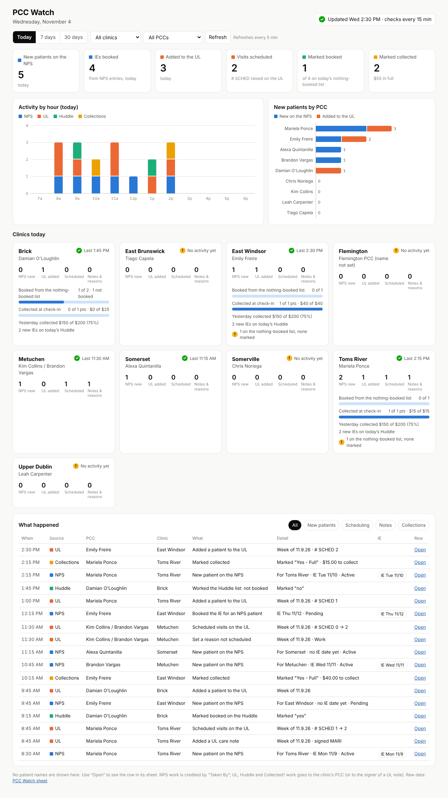

# PCC Watch

Tells you when each PCC puts something new onto the sheets they work in —
the **NPS** and their clinic's **UL** first, plus the **PCC Daily Huddle**
"Booked?" marks and **Patient Responsibility** "Collected?" marks — without
anyone changing how they work.

Every 15 minutes (Mon–Sat, 7 AM–7 PM) a Google Apps Script running as you
takes a snapshot of those sheets and compares it with the last one. What
changed shows up on a **dashboard**: a web page served by the same script
that works on a phone and refreshes itself every 5 minutes.



*The screenshot uses invented sample data.*

## The dashboard

- **Range and filters:** Today, 7 days or 30 days, filtered by clinic or PCC.
- **Totals:**
  - new patients on the NPS
  - IEs booked
  - patients added to the UL
  - visits scheduled
  - Huddle "booked" marks, against today's nothing-booked list
  - "Collected" marks, with dollars
- **Activity chart:** events by hour for today, by day for longer ranges, split
  into NPS, UL, Huddle and Collections. Hover a bar for the counts.
- **New patients by PCC:** NPS entries and UL additions per person. PCCs at zero
  are listed too, so a quiet PCC stands out. Work shared by a clinic's two PCCs
  gets its own "(shared)" row.
- **Clinics today:**
  - one card per clinic, with its PCC and their last activity
  - a "No activity yet" flag in the afternoon
  - Huddle "booked" progress and collection progress against today's targets
  - yesterday's collection rate
- **What happened:** every event, newest first.
  - For each event: when, PCC, the clinic the patient is for, what changed,
    the IE date when the NPS has one, and **Open** to jump to the row.
  - Filter chips: New patients, Scheduling, Notes, Collections.

Nothing on the dashboard identifies a patient. To see who it is, click
**Open**. That opens the row in the source sheet, which only people with
access to that sheet can do.

Behind the dashboard, the script keeps its records in one **PCC Watch**
spreadsheet. You don't need to open it, but it's there:

| Tab | What's on it |
| --- | --- |
| **Today** | One row per PCC clinic: NPS entries, leads claimed, UL patients added / visits scheduled / notes / reasons, Huddle "nothing booked" target vs. marked booked, new IEs, $ to collect today vs. marked collected, yesterday's collection rate (from Prompt), last activity time, and a heads-up column. |
| **Activity** | Every event, newest first: when, PCC, clinic, what, detail, a link straight to the row, and how it was attributed. Kept 60 days. |
| **Roster** | Who the PCCs are. Edit this tab — not the code — when someone joins or leaves. |

You also get email (to yourself):

- **When a PCC puts a new patient on the NPS or UL**, batched so there's at most
  one email every 30 minutes. Any other work since the last email
  (scheduling, notes, marks) rides along as counts.
- **1 PM on weekdays:** one "no activity yet" email listing the PCC clinics with
  nothing new today. It's skipped on days the watcher didn't start before 10 AM.
- **4 PM on weekdays:** a summary of the day per PCC.
- **If a source can't be read for two checks in a row** (a file moved, un-shared, or
  next month's NPS isn't visible yet): one email saying which, so you know the watcher
  is blind there. The problem also shows in red at the top of the Today tab.

## What counts, and who gets credit

| Source | Event | Credited to |
| --- | --- | --- |
| NPS (this month; last month for the first 10 days; next month once it exists) | New row whose **Taken By** names a PCC (`Mariela`, `Auto/ Emily`, `Mariela/Lana` …) | That PCC, by name |
| | Taken By filled in later, or changed from `Auto` / `AI Agent` to a PCC | That PCC: **new entry**, or **claimed lead** |
| | Taken By is a clinic name (`Somerset`, `EB Clinic`) | That clinic's PCC, marked **probable** (Alexa and Tiago type the clinic, not their name) |
| UL (this week's tab and future weeks' tabs) | New patient row · **# SCHED** went up · new care-note line · **Reason not scheduled** set | The clinic's PCC. A note is credited to its signer when signed with a Roster tag (`[MARI]`, `-BV`, `[EMILY]`, `-TC`). Notes signed by non-PCC staff (`[JEROME]`, `[JIBRIL]`, `- AS` …) aren't credited to anyone. |
| PCC Daily Huddle | **Booked? (PCC)** filled on the nothing-booked list (clinic tab or All PCC Clinics; counted once). `yes` counts as booked; `no` or anything else counts as "worked, not booked". | The clinic's PCC |
| Patient Responsibility / Huddle pay table | **Collected?** filled (TODAY or TOMORROW; counted once across both sheets). `Yes - Full`, `Partial` and `Card on File` count as collected; dollars are added only for `Yes - Full`. `No`, `$0 Owed` and anything else count as "nothing collected". | The clinic's PCC |

Not counted as PCC work: rows entered by Auto, AI Agent or central staff
(Lana, Elijah, Lynni, Tiffany, Pia …), Danielle's morning rebuilds of the
Huddle and Patient Responsibility sheets, a corrected name on the same row,
re-sorting, and a newly duplicated UL week tab. A new week tab is
baselined silently, and its creation appears once on the Activity tab.

**Limits to know.** The UL, Huddle and Patient Responsibility sheets have no
"entered by" column, and you only have view access, so the script can't see
who edited a cell. Those events go to the clinic's PCC. At Metuchen,
unsigned UL work is shared between Kim and Brandon. When something happens
between two checks, the time shown is when the script noticed it (within 15
minutes).

## Privacy

The watcher never writes to the sheets it watches. It needs only view
access. Nothing it stores or sends identifies a patient:

- Rows are matched by an HMAC (a keyed hash) of the patient name or account #.
  The key is random, created on first run, and lives only in this project's
  Script Properties.
- Care notes are stored only as hashes of each line. Note text is read in
  memory to find a signature tag, then discarded.
- "Booked?", "Collected?" and "Reason not scheduled" can hold free text. Only
  their category is stored or shown (`yes`/`no`, `Partial`, `Work`, …), with
  `other` / `Other` for anything typed outside the list, never the text itself.
- The Activity tab, Today tab and emails name the PCC, clinic, what changed
  and a **link to the row**. They never contain a patient name, DOB, phone,
  account # or note text.

`node pcc-watch/test/run-tests.js` checks exactly this against made-up
patients. Among its other checks, it fails if any of their names, account
numbers or phones show up in the state file, the PCC Watch sheet, an email or
the log.

## Setup (about 5 minutes)

1. Go to <https://script.google.com> → **New project**, name it **PCC Watch**.
2. Replace `Code.gs` with [`Code.gs`](Code.gs). In **Project Settings**, tick
   "Show appsscript.json", then replace it with [`appsscript.json`](appsscript.json).
3. Check the `CONFIG` block at the top. The file IDs for the Huddle, Patient
   Responsibility and the 9 PCC clinic ULs are already filled in. Optional:
   set `FOLDER_ID` to the familiar's Drive folder so the output lives there.
4. **+ Add a file → HTML**, name it **`Dashboard`** (no extension), and replace
   its contents with [`Dashboard.html`](Dashboard.html).
5. Pick **`setup`** in the function dropdown → **Run** → approve the access it
   asks for:
   - read the sheets
   - create its own sheet and state file
   - send you email
   - run on a schedule

   This creates the **PCC Watch** sheet, takes a first snapshot (no alerts
   for anything already there) and schedules a check every 15 minutes. The
   log prints the sheet's link.
6. **Deploy → New deployment →** gear icon **→ Web app**:
   - **Execute as:** Me
   - **Who has access:** Only myself. "Anyone within Trinity Rehab" is also
     safe if you want to share the page, say with Danielle: visitors can only
     read the dashboard, and the admin functions refuse anyone but you.
     **Don't pick "Anyone"**: that puts PCC activity on the open web.

   Click **Deploy** and bookmark the URL it gives you (on your phone too).
   That's your dashboard. From now on the emails link to it. After changing
   the code later, use **Deploy → Manage deployments → Edit → New version** to
   keep the same URL.
7. Open the PCC Watch sheet's **Roster** tab and fix anything that's off:
   - **Flemington** has no PCC yet. Add the name, plus the first name they
     type in the NPS "Taken By".
   - **Upper Dublin** is set to **Leah Carpenter**, from the PCC Regroup
     invite and the NPS. Confirm it.
   - The note tags for Kim (`KC`), Alexa (`AQ`), Chris (`CN`) and Leah (`LC`)
     are guesses. Today only Mariela (`MARI`), Brandon (`BV`), Emily (`EMILY`)
     and Tiago (`TC`) sign UL notes.

   Changes take effect on the next check.
8. Pick **`backfill`** in the function dropdown → **Run**. It fills the dashboard
   with history from the first day of last month, so last month's and this
   month's NPS are both covered (see below). It takes a minute or two.

### Backfill: history from before the watcher started

The watcher only sees changes from the moment it starts. `backfill` adds what
the sheets can date from before then:

- **NPS.** Every patient a PCC entered, in both last month's and this month's
  NPS. Each is dated by its call date (no time of day) and credited by "Taken
  By", with its clinic, IE date and status.
- **UL.** Care-note lines that start with a date, such as `11/3 lm [MARI]`,
  credited to the signer, or to the clinic's PCC when unsigned.

UL scheduling changes and Huddle / Collected? marks carry no date, so they
only count from when the watcher started.

Backfilled rows show up on the dashboard and in the Activity tab. Their
"Backfilled" column reads `date` (date only) or `time` (exact time). You can
run `backfill` again at any time: it replaces what it added before, and it
never double-counts anything the watcher saw live. To start from a different
date, set `BACKFILL_FROM` (for example `'2026-09-15'`).

### Updating to a new version

1. Paste the new `Code.gs` and `Dashboard.html` over the old ones and save.
2. Go to **Deploy → Manage deployments**, click the pencil icon, set
   **Version: New version**, then **Deploy**. The dashboard link stays the
   same. (Scheduled checks pick up the new code as soon as it's saved; the
   dashboard only does after this step.)
3. If the release notes say so, run `backfill` again.

Other functions you can run from the dropdown:

| Function | What it does |
| --- | --- |
| `backfill` | Add history from before the watcher started (see above). Safe to re-run. |
| `runNow` | Run a check now, even outside the schedule. |
| `removeTriggers` | Stop the watcher. Keeps the sheet. |
| `installTrigger` | Start it again, or apply a new `TRIGGER_EVERY_MINUTES`. |
| `resetSnapshots` | Forget all snapshots. The next check re-baselines silently. Use it if a source sheet was restructured, or if the state file got damaged. |
| `forgetOutputSheet` | Only if you deleted the PCC Watch sheet: run this, then `setup` makes a new one. You'll need to re-enter Roster edits. |

To change the schedule, emails or retention, edit `CONFIG`:
- `RUN_DAYS`, `RUN_FROM_HOUR`, `RUN_TO_HOUR`
- `NOTIFY`, `NOTIFY_EMAILS`, `NOTIFY_ON`, `NOTIFY_EVERY_MINUTES`
- `QUIET_CHECK_HOUR`, `DAY_SUMMARY_HOUR`
- `LOG_DAYS_KEPT`

If a source moves (a new UL file, a new Huddle), update its ID in `CONFIG`.
New monthly NPS files are found by title automatically. The UL files are
per year ("UL 2026"). When the 2027 files start, put their IDs in
`UL_FILES`. Until you do, the Today tab and the "can't read" email will flag it.

If Google has a passing problem opening a file, the check retries and then
skips that run. It never starts a new PCC Watch sheet or forgets what it
has seen, so nothing gets logged twice or missed.

## Tests

```
node pcc-watch/test/run-tests.js
```

To see the dashboard with made-up sample data (screenshots in light, dark,
phone and hover views):

```
node pcc-watch/test/preview-dashboard.js /tmp/pcc-preview
```

The tests run `Code.gs` under Node against fake Apps Script services
(`test/gas-mock.js`) and made-up sheets shaped like the real ones
(`test/fixtures.js`). They
simulate a full day plus the next morning's rebuilds and check:
- every event type and how it's credited
- re-sorting, corrected names and new week tabs
- the Huddle / Patient Responsibility dedupe and rebuilds
- email batching and the once-a-day emails
- an unreadable source
- the privacy check above

There is also one regression test for each issue found in an independent
review:
- Google hiccups and a damaged state file
- mail outages
- free text in the mark columns
- non-PCC note signers
- tag look-alikes
- marks made right after a rebuild
- a patient added to two week tabs
- re-credited NPS rows
- a missing NPS
- out-of-order Activity rows
- late-evening events
- stale Huddle targets
- tabs you add
- invalid trigger intervals
